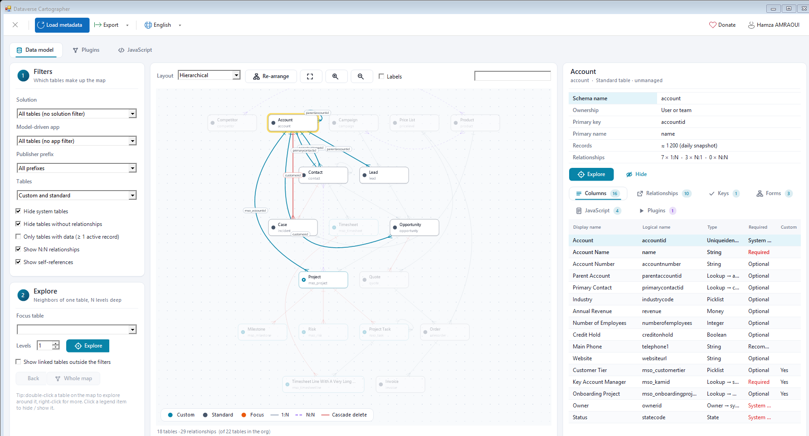
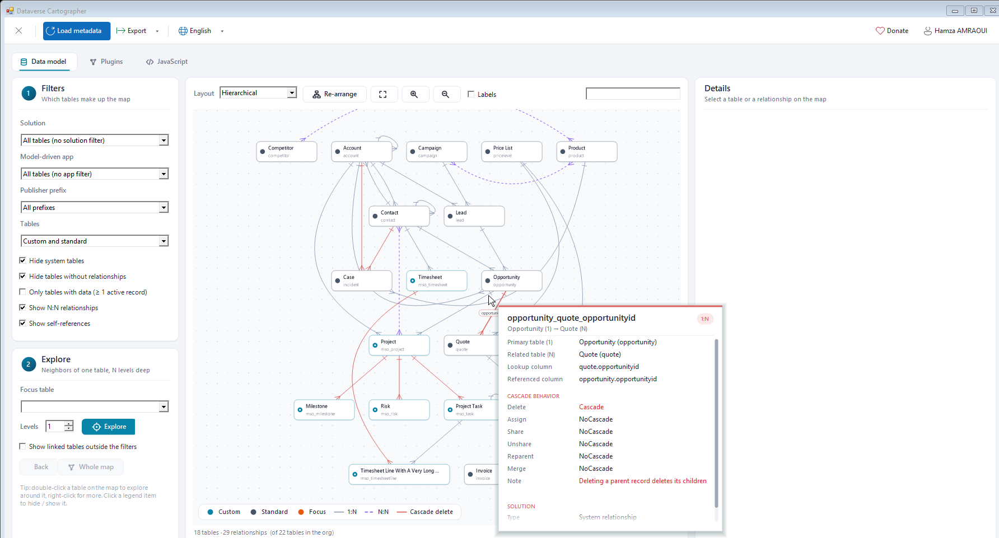
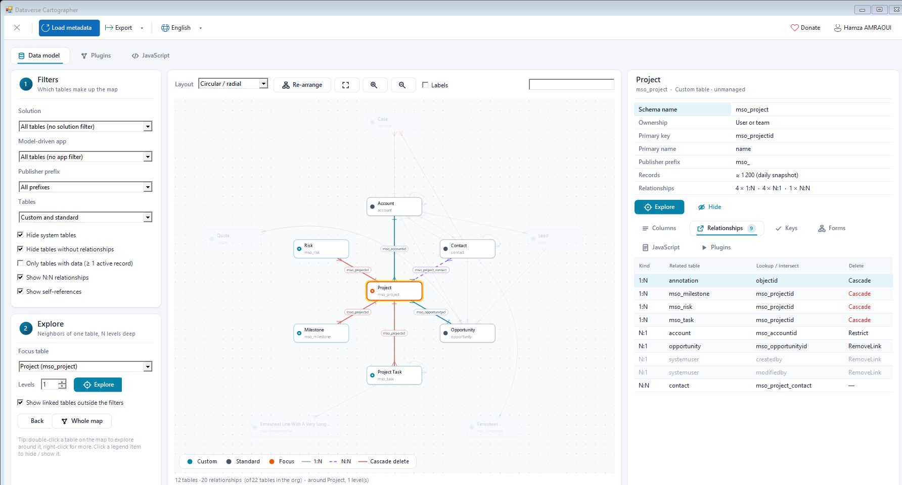
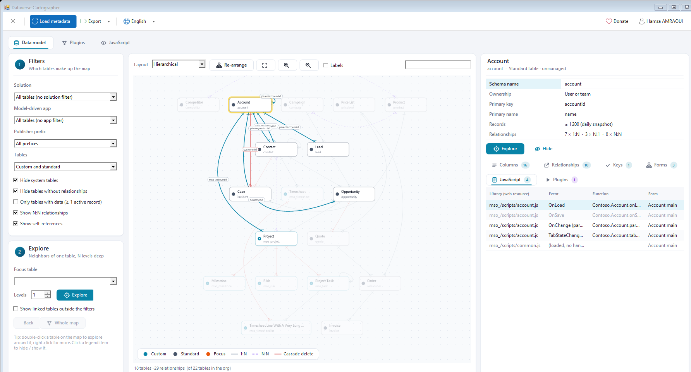
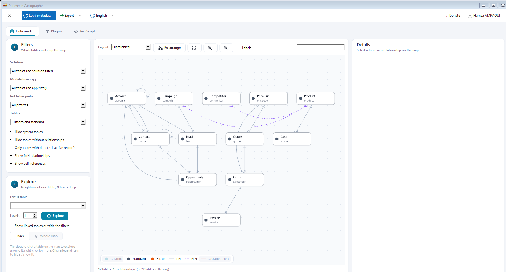
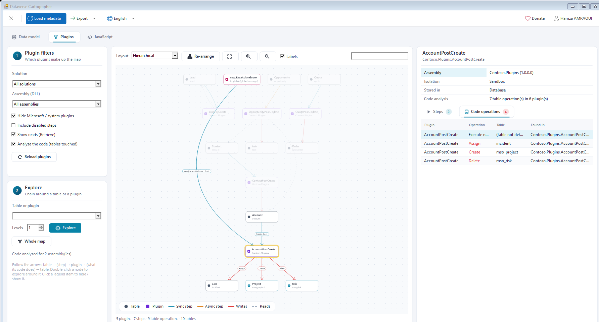
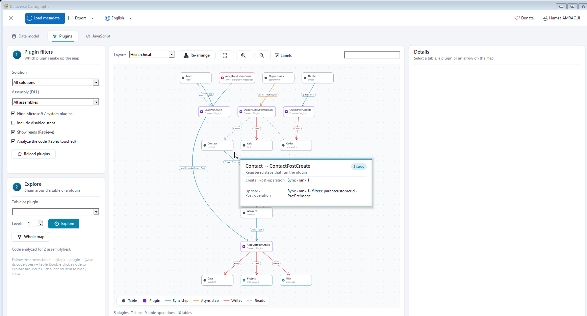
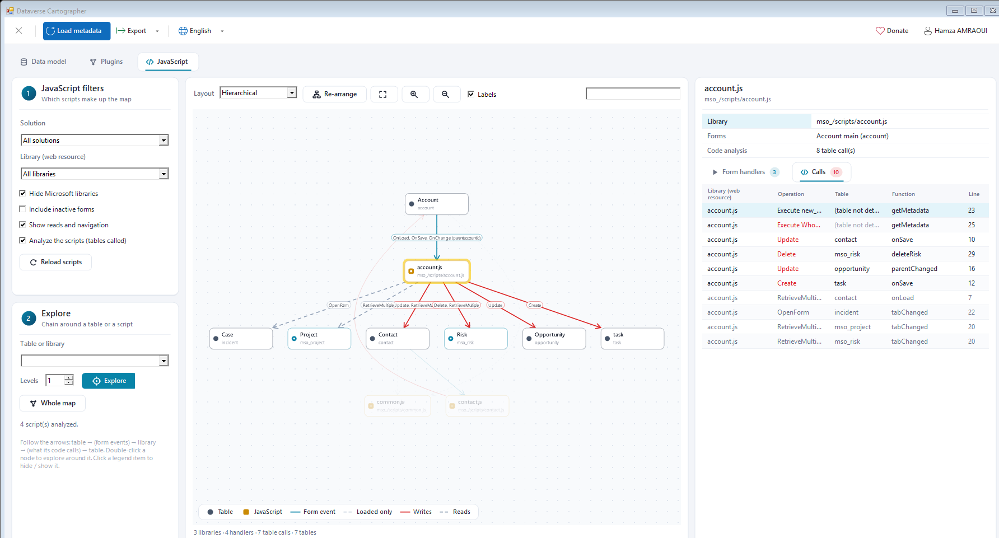
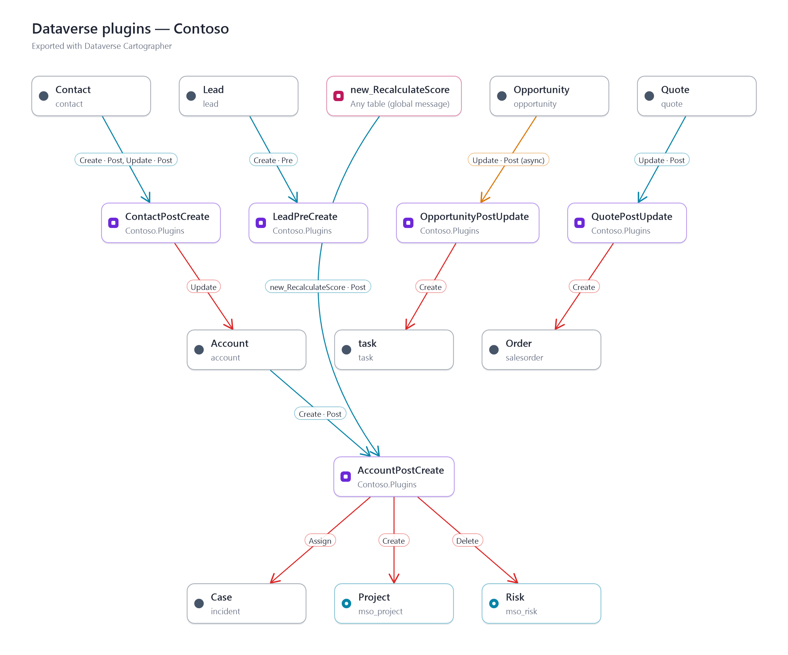
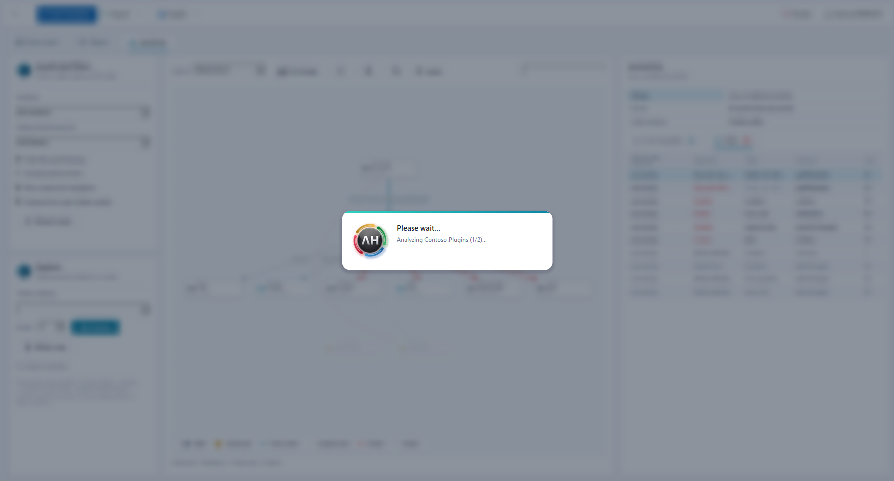

<p align="center"></p>

# Dataverse Cartographer (XrmToolBox plugin)

**Map your org's tables and relationships**, and the logic around them.

Dataverse Cartographer draws an interactive map of a Dataverse / Dynamics 365 organization:

- **Data model**: tables and their 1:N, N:1 and N:N relationships, with cascade behaviors, columns, keys, forms, JavaScript and plugin steps.
- **Plugins**: which plugin runs on which table, and what its code does next (*a PostCreate of a contact updates the account*).
- **JavaScript**: which form events call which script, and which tables the script then reads or writes.

Understand a model in minutes, document a solution or an app, or prepare an impact analysis before a change. English / French. Nothing is ever written to the organization.



*Data model of a sample organization. Account is selected: its relationships are highlighted and its card shows the columns, relationships, keys, forms, JavaScript and plugins.*

---

## Features

### Data model map

| | |
|---|---|
| **Interactive graph** | Zoom (mouse wheel), pan (drag the background), move tables by hand. Four layouts: hierarchical (the « one » side above the « many » side), force-directed, circular / radial, grid. Edges that would cross a table are bent around it. Crow's-foot notation: bar = one, prongs = many; N:N dashed; **cascade-delete relationships in red**. |
| **Filters** | **Solution**, **model-driven app** (the tables of the app, sitemap included), **publisher prefix** (`contoso_`…), custom / standard tables, hide system tables (`systemuser`, `team`, `activitypointer`, `annotation`…), hide tables without relationships, show or hide N:N and self-references. Filters combine: *app + solution* keeps the tables found in both. |
| **Only tables with data** | Keeps the tables that hold **at least one active record**. Every table is checked on the server once per connection, after a confirmation (it can take a few minutes on a large organization). The table card also shows the approximate record count. |
| **Clickable legend** | Click *Custom*, *Standard*, *1:N*, *N:N*, *Cascade delete* or *Focus* at the bottom of the map to hide or show that category. Items can be combined, and the remaining tables keep their position. |
| **Exploration** | Pick a table (or double-click it) to keep only its neighbors, 1 to 6 levels deep. Optionally show, faded, the linked tables excluded by the filters. *Back* returns to the previous table. |
| **Hover cards** | Hover a table or a relationship for a precise card: lookup and referenced columns, the full cascade behavior, managed / custom, record count. Long cards scroll. |
| **Table card** | Schema name, ownership, primary key / name, prefix, records, relationship counts, then six tabs: **Columns**, **Relationships** (seen from the table), **Keys** (alternate keys), **Forms**, **JavaScript** (every handler of every form: library, event, function) and **Plugins** (registered steps). Loaded on demand in the background. |
| **Search** | Finds a table, a lookup column or a loaded column on the map; Enter cycles through the matches. A table that is not displayed can be explored straight from the search box. |



*Hover card of a 1:N relationship: tables, lookup column and cascade behavior. Deleting an opportunity deletes its quotes.*



*Radial exploration around Project, with the tables linked from outside the filters shown faded.*



*JavaScript tab of the table card: every form handler (OnLoad, OnSave, OnChange of a column, tab state change) and the libraries loaded without any handler.*



*Custom tables and cascade-delete relationships hidden from the legend.*

### Plugin map

A technical map that reads as a chain: **table → (step) → plugin → (what its code does) → table**.

For example: `Contact —[Create · Post]→ ContactPostCreate —[Update]→ Account —[Create · Post]→ AccountPostCreate —[Create]→ Project`.

- **Filters**: solution, **assembly (DLL)** (the list only shows the DLLs of the selected solution), hide Microsoft / system plugins, include disabled steps, show reads.
- **Triggers** (table → plugin): the registered steps, grouped by message and stage. Sync steps are blue, async steps amber. Steps on global messages (custom APIs, actions) and service endpoints are shown too.
- **Actions** (plugin → table): found by a **static analysis of the plugin code**:
  - **Where the DLL comes from**: the organization (database assemblies, or the DLL inside a plugin package). It is read with a built-in ECMA-335 metadata reader and never loaded.
  - **What is detected**: SDK calls (`IOrganizationService.Create / Update / Delete / Retrieve…`, `XxxRequest`, `OrganizationServiceContext`) and the tables they target (`new Entity("account")`, early-bound classes, `QueryExpression`, FetchXML, `Target = new EntityReference("incident", id)`).
  - **How deep**: the calls inside the assembly are followed (helpers, services behind interfaces, base plugin class).
- **Details**: the steps (stage, mode, rank, filtering attributes, images) and the code operations (operation, table, method where they were found).



*Plugin map: AccountPostCreate runs on the creation of an account and on a custom API; its code assigns a case, creates a project and deletes a risk.*



*Hover card of a trigger: the two steps that run ContactPostCreate, with their filtering attributes and images.*

### JavaScript map

The same idea for the form scripts: **table → (form events) → library → (what its code calls) → table**.

For example: `Account —[OnLoad, OnSave, OnChange (parentaccountid)]→ account.js —[Update]→ Contact`.

- **Filters**: solution (the library list then only shows its scripts), library, hide Microsoft libraries (`msdyn_`, `mscrm`, `adx_`…), include inactive forms, show reads and navigation.
- **Triggers** (table → library): the handlers of every form of the table. Libraries loaded without any handler are drawn dashed.
- **Calls** (library → table): found by reading the web resource. Each call is attached to its function and line. Detected:
  - `Xrm.WebApi` (createRecord, updateRecord, deleteRecord, retrieveRecord, retrieveMultipleRecords, also through an alias);
  - Web API URLs (`/api/data/v9.2/accounts`, with the HTTP verb used);
  - FetchXML;
  - `openForm` / `navigateTo` / `lookupObjects`;
  - custom API calls (`operationName`).



*JavaScript map: account.js is called by three events of the account main form; its code updates contacts and opportunities, creates tasks and deletes risks.*

### Exports

Exports apply to the map of the current tab, as displayed (filters and legend included):

| Format | Content |
|---|---|
| **PNG / SVG** | The whole map (not only the visible area) with a title line. |
| **Mermaid / PlantUML** | `erDiagram` for the data model, flowchart for the plugin and JavaScript maps. Saved as `.mmd`, `.md` with a fenced block, or `.puml`, or copied to the clipboard. |
| **Excel** | Data model: tables, relationships with cascades, columns. Plugins: steps and code operations. JavaScript: form handlers and script calls. |



*The plugin map exported as PNG, ready for a wiki.*

### Look and feel

The tool shares the command bar and the « AH » icon of Entity Fields Analyser. Long operations run behind a loading screen with the animated « AH » icon and the current step. Messages use modern dialogs, and errors come with expandable technical details.



---

## Usage

1. Open **Dataverse Cartographer** in XrmToolBox and connect to an organization: the data model is loaded and drawn.
2. **Data model**:
   - Narrow the map with the **filters** (solution, model-driven app, publisher, table types…).
   - Double-click a table to **explore** around it.
   - Click a table or a relationship for its details, and hover it for a quick card.
3. **Plugins**: pick a solution, then an assembly if needed. The code of the assemblies on the map is analyzed automatically (the first time only). Double-click a plugin or a table to follow its chain.
4. **JavaScript**: the forms and their scripts are read the first time the tab is opened. Pick a solution or a library, then follow the arrows.
5. Click the **legend** to hide or show a category, and **Export** what you see.

### Things to know

- **Static analysis is a heuristic.** Table names built at runtime (configuration, parameters, variables) cannot be seen; such operations are listed as *table not detected*. A plugin entity built in one method and saved in another is linked and flagged as *inferred*. Inside nested JavaScript functions, the function shown can be the inner one, but the line number is always exact.
- **On-premises assemblies** stored on disk or in the GAC have no code in the organization: only their steps are drawn.
- **Opening the JavaScript tab** reads the forms of every table. They are filtered on the server to the forms that load a library when the organization allows it, which can take a moment on a large organization.
- **The approximate record count** comes from the platform snapshot, refreshed about once a day. The *Only tables with data* filter does not rely on it: it checks each table live.

## How it reads the organization

| Data | How |
|---|---|
| Tables and relationships | One light `RetrieveMetadataChanges` query for the whole organization, with only the properties the map needs. If the environment rejects it, the tool falls back to `RetrieveAllEntities`. |
| Solutions, publishers, apps | `solution` (visible ones), `publisher`, `appmodule`. The tables of a solution come from `solutioncomponent`, those of an app from `RetrieveAppComponents`. Both are cached. |
| Columns and keys | `RetrieveEntity`, when a table card is opened (or for the Excel inventory, on request). |
| Usage | `RetrieveTotalRecordCount` (approximate counts), then a 1-row query per table, sent by batches through `ExecuteMultiple`. |
| Plugins | `pluginassembly`, `plugintype`, `sdkmessageprocessingstep` (with `sdkmessage` / `sdkmessagefilter`), `sdkmessageprocessingstepimage`. The assembly content (or the plugin package) is read only for the assemblies on the map. |
| JavaScript | `systemform` (form XML), `webresource` (content of the libraries on the map). |

## Build

```
dotnet build -c Debug
```

.NET Framework 4.8. The tool is a single DLL with no dependency other than `XrmToolBoxPackage`: the whole interface is drawn with GDI+, and the code analysis uses no third-party library. In Debug, the DLL is copied to `%AppData%\MscrmTools\XrmToolBox\Plugins` after each build (`-p:DeployToXrmToolBox=false` to skip it).

## Roadmap

- Saved views (table selection and positions), shareable with the team.
- Environment comparison (DEV / UAT / PROD): added, removed and changed tables, relationships, plugins and scripts.
- Impact analysis: *if I delete this column or relationship, what is touched?*
- Anomaly detection: orphan tables, risky cascade deletes on sensitive tables, unused lookups.

## Author

Hamza AMRAOUI — [LinkedIn](https://www.linkedin.com/in/hamza-amraoui/)
